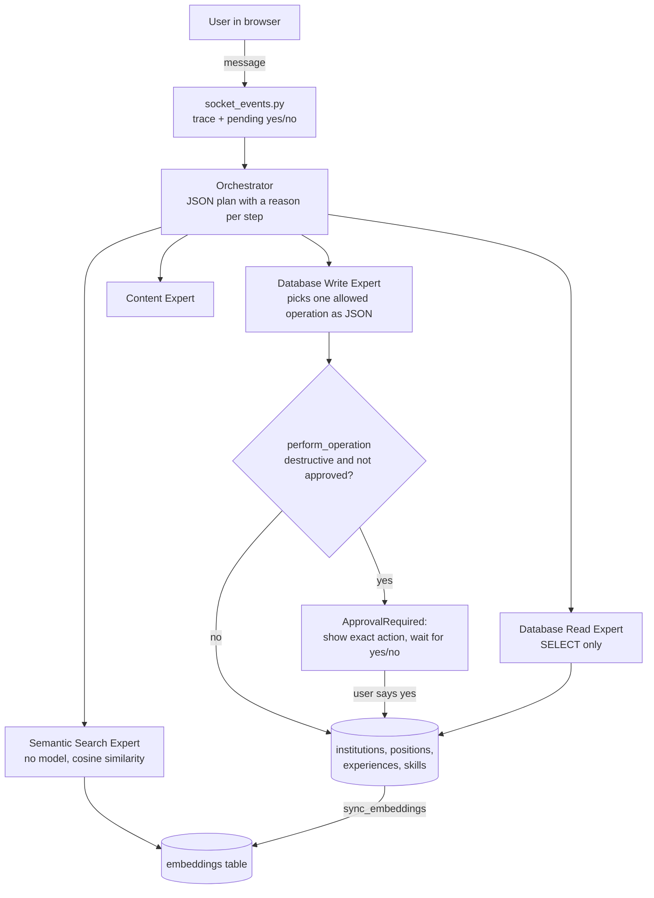

# Design and Testing Report — Homework [2]

Name: Nabeel Alsultan
GitHub fork/branch URL: https://github.com/AlsultanNabeel/ai-agents/tree/nabeel-homework-2
Demo video link: https://drive.google.com/drive/folders/1JmSm2xL3SeTMOlqSB_RrRZp4dAN_5p3h?usp=sharing
Command that runs my tests: `python tests/run_scenarios.py` (run it from the homework 2 folder)

## 0. Starting point

Before writing anything new I went through the four checks on my HW1. The app worked: a read question answered "You have 5 skills" and adding a skill worked. The `db = current_app.db` fix was already in place. I didn't have to change code for the code fences, since my prompts in `llm_roles.csv` already tell the model not to use markdown or fences.

The restart test failed. I added Rust, restarted the app, and it was gone, because `createTables(purge=True)` dropped every table and reloaded it from the CSV files on every start. I also found where model output was being executed: `eval()` ran the Orchestrator's plan and `exec()` ran the Write Expert's code, both in `llm.py`. Finally I sent one sentence to `nvidia/nemotron-3.5-embed-8b:free` and got back a vector of 4096 numbers that wasn't all zeros.

So the first thing I fixed was startup, so the data stays after a restart.

## 1. How my system works



A message comes in through `socket_events.py`, which gives it a request number for the trace and also keeps any action that is waiting for a yes or no. The Orchestrator then writes a plan as JSON, where each step has the expert's name, a message, and a short reason. My code reads it with `json.loads` and rejects any expert name it doesn't know.

The Semantic Search Expert doesn't call a model at all. It turns the user's question into an embedding, compares it to the stored embeddings with cosine similarity, and returns the closest records with their table, ID, text and score. The Write Expert no longer writes Python. It picks one of three allowed operations and fills in the values as JSON, and my code checks every value. All writes go through one function, `perform_operation`, and that's where the approval check is: if the operation is destructive and hasn't been approved, it doesn't run.

Compared to HW1, the data now survives a restart, there's a new embeddings table and a search by meaning, there's a new expert for that search, the plan is JSON instead of going through `eval()`, `exec()` is gone and replaced by the list of allowed operations, deletions wait for a yes, every message prints a trace, and one command runs all the scenarios.

## 2. Where to find things in my code

The search itself is `search()` in `flask_app/utils/embeddings.py`, and the expert that calls it is `run_semantic_search()` in `flask_app/utils/llm.py`. It returns the table, ID, text and score for each result. Embeddings are created and kept up to date by `get_embedding()` and `sync_embeddings()` in the same file, and they're stored in the `embeddings` table (`create_tables/embeddings.sql`).

The trace is printed by `handle_message()` and `end_trace()` in `flask_app/utils/socket_events.py`, and each plan step is printed in `run_orchestrator_plan()` in `llm.py`. The test command is `tests/run_scenarios.py`. The settings are listed in `homework 2/.env.example`: `OPENROUTER_API_KEY`, `EMBEDDING_MODEL` and `SEARCH_MIN_SCORE`.

The approval check and the allowed operations are in `flask_app/utils/operations.py`, in `ALLOWED_OPERATIONS` and `perform_operation()`. The action waiting for a yes is kept in `pending_actions` in `socket_events.py`. Startup is `createTables()` in `flask_app/utils/database.py`.

## 3. Three decisions I made

Decision 1, how startup keeps the data. I looked at three options: keep purge=True, switch to purge=False on its own, or load the resume once and the prompts every time. I tried purge=False alone first, and a deleted skill came back after a restart and a prompt edit didn't take effect, because the CSV is loaded with INSERT OR IGNORE on every start. So I went with the third one. The resume tables load from CSV only when the database is new (I check if the skills table exists before the tables are created), and the prompts in llm_roles are cleared and reloaded on every start. The downside is that editing the resume CSVs only shows up after a reset. If I edited the resume through the files more than through the chat, I'd change this.

Decision 2, which tables to search and what counts as no match. I measured on the fixtures before deciding. Asking "What AI skills do I have?" over all tables put a Researcher position first at 0.30, and the first skill only came fourth. Searching only the skills table gave NLP at 0.19, Machine Learning at 0.18 and Public Speaking at 0.09. So questions with the word "skill" only search the skills table, and everything else searches all tables. For the cut-off, wrong matches like Harvard or cooking went up to 0.13 and the right ones started at 0.18, so I put the line in the middle at 0.15. It's read from SEARCH_MIN_SCORE in .env, with 0.15 as the default. The gap is small, so if new questions gave wrong matches above 0.15 or right ones below it, I'd have to move it.

Decision 3, how a yes gets matched to the action. One option was to send the message back to the model after the yes, but the model might come up with a different action the second time. So I store the operation itself, its name and values, in memory for each chat session, and a yes runs exactly that, without asking the model again. Anything other than yes or no cancels it and gets answered as a new message, so a late yes can never approve something old. The downside is that a restart loses the waiting action, which is safe because nothing runs, and after a "maybe" the user has to ask again. If the app ran on more than one server or the waiting action had to survive a restart, I'd keep it in a table instead.

Decision 4, a separate search expert. I could have added search to the Read Expert, but I made a new expert that doesn't call a model and just runs search(). It's clearer in the trace and it saves a model call. It searches with the user's original question, because the Orchestrator was shortening it to things like "Harvard experience", and that pushed HTML up to 0.19, above the cut-off. If search had to handle more complicated questions with several parts, I'd think about this again.

## 4. Testing

The test command builds its own database from `fixtures/` (`tests/test_resume.db`), sends each scenario through the real chat handler, and checks the trace and the database before and after. All 11 scenarios passed.

S1, "Find my MSU experience". Michigan State University should be near the top with scores in the trace. It was the top result, institutions #1 at 0.383. Pass, shown in the test output and the trace.

S2, "What AI skills do I have?". Machine Learning should come back and Public Speaking shouldn't, or should rank lower. Only NLP (0.194) and Machine Learning (0.182) came back. Pass.

S4, "What did I do at MSU?". This needs two steps where the second uses what the first found. Step 1 found the university, and step 2's SQL used WHERE i.name = 'Michigan State University'. Pass, shown in the trace.

S6 and S7, "Remove Python from CSE 847", then no, then the same request with yes. The exact action should be shown, no should change nothing, and yes should delete only that. It showed "This will delete skill 'Python' from experience 'CSE 847'", no left everything as it was, and yes removed only Python from CSE 847. Pass, checked by comparing the skills before and after.

S9, "Clean up my skills so the list is empty". It should stop and ask even without the word delete. It replied "This will delete ALL skills from the database. Reply yes or no." Pass.

S10, a failure scenario where I set a wrong embedding model name. It should give a clear error, store nothing, and keep working. It replied "Search failed: the embedding service is unavailable...", the number of embeddings didn't change, and the next question still got "You have 4 positions." Pass.

S11, also a failure scenario, "Find my Harvard experience". It should say not found and not make anything up. Nothing scored above 0.15 and the reply was "No matching records found." Pass, and the trace shows no scores.

A few things surprised me along the way. The first version of `sync_embeddings` deleted all the good embeddings when I set a wrong model name. I caught that in a test and changed it so an old vector is only removed if the row's text actually changed. I also noticed the Orchestrator was shortening questions before searching, which made HTML score above the cut-off for Harvard, so now the search uses the user's own question, which is what I measured the cut-off on.

With `eval()`, the model sometimes left out a quote in its plan and the user just got "Sorry, I couldn't plan a response". With JSON a bad plan gets rejected with a clear line in the trace. When I changed the prompt examples to ones from my own resume (AUC, embedded systems skills), S2 started going to the Read Expert, so I added a clearer rule for questions about skills in some area. And the free embedding model is slow sometimes and a few requests timed out. Those were rejected and not stored, and they got filled in on the next start.

## 5. Limitations

1. Limitation: the cut-off has a small margin, wrong matches reached 0.13 and right ones started at 0.18. Impact: a question worded differently could return a wrong record or miss the right one. How I'd improve it: test on more questions, and also look at the gap between the first and second result instead of using one fixed number.
2. Limitation: whether to search only skills depends on the word "skill" being in the question. Impact: something like "What do I know about AI?" searches every table, so experiences can show up above skills. How I'd improve it: have the Orchestrator say which tables to search in the plan, and check that in code.

## 6. My work and the help I used

I used Claude Code for ehlping me in this homework..

I made the decisions: a separate search expert, prompt examples taken from my own resume, keeping the cut-off in .env with a default, and using a free embedding model. I pasted the code into the project myself for most of the steps and went through it, wrote comments, ran the app and tried things in the chat, and fixed an indentation error.

The libraries are Flask, Flask-SocketIO, requests, python-dotenv, sqlite3, json and math. Cosine similarity is written by hand. The test data is a provisional copy of the fixtures that a classmate shared, which is the course's original sample resume plus Machine Learning, NLP and Public Speaking. After getting help I replaced the prompt examples with ones from my own resume instead of the test questions and ran the whole test again.

## 7. How to run it

```bash
bash setup.sh                 # from the repo root, once
source venv/bin/activate
cd "homework 2"
python app.py                 # http://localhost:8080
python tests/run_scenarios.py # S1–S11, PASS/FAIL
```

The `.env` file at the repo root needs `OPENROUTER_API_KEY`, `EMBEDDING_MODEL`, and optionally `SEARCH_MIN_SCORE` (default 0.15).

To reset only the test data: the test command rebuilds `tests/test_resume.db` from `fixtures/` every time it runs. To do it by hand, delete that file with `rm tests/test_resume.db`. That never touches `flask_app/database/resume.db`, which holds my real data.
