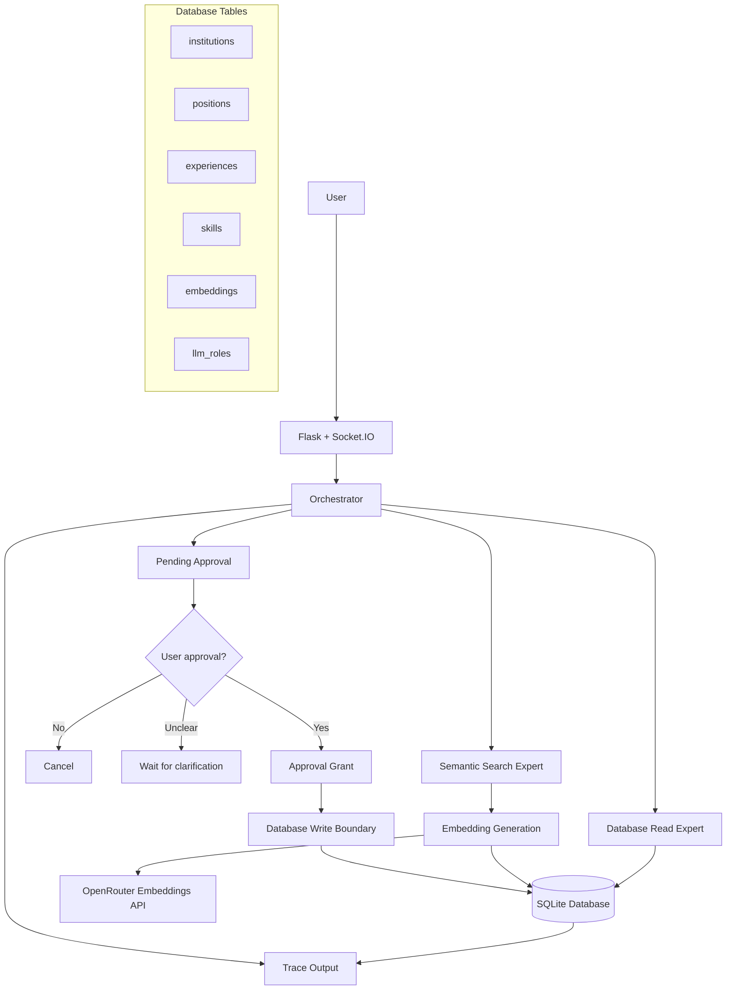

# Design and Testing Report — Homework 2

**Name:** Dima
**GitHub fork/branch URL:** [Add your fork URL]
**Demo video link:** [Add your demo link]
**Command that runs my tests:** `python tests/run_scenarios.py`

## 0. Starting point

HW1 provided the Flask resume application and SQLite database. HW2 extended it with persistent semantic embeddings, specialized expert routing, request tracing, and approval-controlled database writes.

**Before-start checks:** [Document the actual HW1 restart, embedding, and `eval()`/`exec()` checks you completed, including any fixes.]

## 1. How my system works

### Architecture



### Main components

- **Flask and Socket.IO:** Handle the web application and real-time chat communication.
- **Orchestrator:** Interprets the request and routes it to the appropriate expert.
- **Database Read Expert:** Handles structured database questions and exact lookups.
- **Semantic Search Expert:** Searches resume information using stored embeddings and cosine similarity.
- **SQLite:** Stores resume records, expert instructions, and embeddings.
- **Approval mechanism:** Holds proposed destructive actions until the user confirms them. The database validates a one-time approval grant before executing the deletion.
- **Request tracing:** Records routing decisions, approval states, and operation outcomes.

**What changed from HW1:** HW1 provided the basic resume application and AI interaction. HW2 introduced specialized expert routing, semantic search, persistent embeddings, request tracing, and approval-controlled destructive operations.

## 2. Where to find things in my code

| What | File / function / table |
|---|---|
| Search by meaning | `flask_app/utils/embeddings.py` — `semantic_search()` |
| Cosine similarity | `flask_app/utils/embeddings.py` — `cosine_similarity()` |
| Embedding generation | `flask_app/utils/embeddings.py` — `generate_embedding()` |
| Trace output | `flask_app/utils/socket_events.py` — `log_request_trace()` |
| Test command | `tests/run_scenarios.py` |
| Settings | `.env.example` |
| Approval handling | `flask_app/utils/socket_events.py` — `handle_message()`, `handle_approve_write()` |
| Approval validation | `flask_app/utils/database.py` — `ApprovalGrant`, `build_deletion_fingerprint()` |
| Allowed deletion operations | `flask_app/utils/database.py` — `delete_skill_records()` |
| Embedding storage | SQLite `embeddings` table |
| Resume data | SQLite `institutions`, `positions`, `experiences`, and `skills` tables |

## 3. Three decisions I made

| Decision | Options I considered | What I chose | Why, and the trade-off | What would make me choose differently |
|---|---|---|---|---|
| 1. Embedding storage | External vector database, in-memory vectors, SQLite | Store embeddings in SQLite | Keeps resume records and their embeddings persistent in one database without introducing another service. The trade-off is that searching and comparing vectors in Python is less efficient at larger scales. | A much larger dataset or higher search latency would justify a dedicated vector database. |
| 2. Similarity threshold | Return all ranked results or filter by a minimum similarity score | Use a threshold of `0.40` | Prevents weak matches from being presented as relevant. The trade-off is that some valid but differently worded queries may be excluded. | A larger evaluation dataset showing frequent missed matches would justify tuning the threshold or using hybrid lexical and semantic search. |
| 3. Destructive-action approval | Execute immediately, regenerate the action after confirmation, or preserve the exact proposed action | Store the pending action and require a one-time fingerprint-matched approval grant | Ensures that confirmation applies to the exact proposed operation and skill IDs. It also prevents grant reuse. The trade-off is additional state management and approval-flow complexity. | A multi-user or multi-worker deployment would require durable, shared approval state rather than in-memory session storage. |

## 4. Testing

The local test runner currently executes S6, S7, S8, and S10. The other scenarios have not yet been executed by the current runner.

Some scenarios can be tested using mocked AI responses and real database operations. Others require the actual embedding API to verify semantic search integration.

| Scenario / what I typed | What should happen | What actually happened | Pass / fail | Evidence |
|---|---|---|---|---|
| S1 — Search by meaning | Relevant records should be returned and ranked by similarity. | Not yet executed by the test runner. | NOT TESTED | Not yet available. |
| S2 — Search by abbreviation/category | Relevant records should be found and ranked. | Not yet executed by the test runner. | NOT TESTED | Not yet available. |
| S3 — Structured database query | The Database Read Expert should handle the request and execute a safe query. | Not yet executed by the test runner. | NOT TESTED | Not yet available. |
| S4 — Dependent expert steps | The required experts should execute in sequence. | Not yet executed by the test runner. | NOT TESTED | Not yet available. |
| S5 — Restart persistence | Resume records and stored embeddings should remain available after restarting the application. | Not yet executed by the test runner. | NOT TESTED | Not yet available. |
| S6 — Reject a proposed deletion with `no` | The proposed deletion is cancelled and the database remains unchanged. | The skill remained in the database and the proposal was cancelled. | PASS | Local test output and before/after database counts. |
| S7 — Approve a proposed deletion with `yes` | Only the exact proposed skill is deleted. | The approved skill was deleted. The trace outcome was corrected to report `completed` after checking the database operation's return status. | PASS | Local test output and trace outcome. |
| S8 — Reply ambiguously or change the subject while approval is pending | Ambiguous replies must not execute the action. A new request must invalidate the old proposal. | Ambiguous replies left the proposal waiting. A new request invalidated the previous proposal, so a later confirmation could not execute it. | PASS | Local test output and pending-action state. |
| S9 — Grounded response | Responses should be based on retrieved data and honestly report when no matching data is found. | Not yet executed by the test runner. | NOT TESTED | Not yet available. |
| S10 — Embedding generation failure | The error should be reported without corrupting the database or preventing normal database operations. | The mocked embedding failure was handled, and the database remained usable. | PASS | Local test output showing the handled `EmbeddingError`. |
| S11 — API or operation failure | The system should report the failure honestly and remain usable. | Not yet executed by the test runner. | NOT TESTED | Not yet available. |

### Test results

The latest local test run reported:

- S6: PASS
- S7: PASS
- S8: PASS
- S10: PASS
- S1–S5, S9, and S11: NOT TESTED

The test command was:

```bash
python tests/run_scenarios.py
```

The remaining scenarios will be added to the test runner using isolated database operations and mocked AI responses where appropriate. S1 and S2 will also require testing the actual embedding API integration.

These results demonstrate the locally tested approval and embedding-failure behavior, but do not establish that all eleven scenarios pass.

### Surprises and fixes

During testing, I found that the approval write method returned a status field, while the Socket.IO handler checked a different field to determine whether the operation succeeded. This caused the trace to report an incorrect outcome even when the database operation succeeded.

I corrected the trace condition to check `result.get("status") == "success"` and reran the test. S7 then reported the correct `completed` outcome.

## 5. Limitations

1. **Limitation:** The fixed semantic similarity threshold can exclude relevant queries. For example, a query about Python programming skills may receive a maximum score below `0.40`.
   **Impact:** Some relevant information may not be returned.
   **How I'd improve it:** Evaluate more representative queries, tune the threshold, and consider combining semantic and keyword search.

2. **Limitation:** Pending approvals are stored in an in-memory dictionary associated with a Socket.IO session.
   **Impact:** Pending proposals are not durable across application restarts and are not shared between multiple application workers.
   **How I'd improve it:** Store pending approvals in a persistent database or shared state store with expiration and session validation.

## 6. My work and the help I used

I worked on extending the existing Flask and SQLite application with semantic search, embedding persistence, expert routing, approval handling, request tracing, and scenario tests.

I used Python libraries including Flask, Flask-SocketIO, SQLite, requests, and python-dotenv, along with OpenRouter's chat and embedding APIs.

I also used documentation and AI assistance to review implementation details, troubleshoot errors, improve test coverage, and organize the design report. I checked the resulting changes against the application code and reran the relevant tests.

## 7. How to run it

### Requirements

- Python and pip
- An OpenRouter API key
- An embedding model available through OpenRouter

### Setup

```bash
python -m venv venv
source venv/bin/activate
pip install -r requirements.txt
cp .env.example .env
```

Configure the following settings in `.env`:

- `OPENROUTER_API_KEY`
- `EMBEDDING_MODEL`
- `RESUME_DB_PATH` (optional; overrides the default database location)

### Run the application

```bash
python app.py
```

### Run tests

```bash
python tests/run_scenarios.py
```

The scenario runner uses an isolated temporary SQLite database so that test operations do not modify the actual resume database.

### Reset test data

The test runner creates a fresh temporary database for each run. Its temporary database is removed when the test process exits. No manual deletion of the actual resume database is required.

**Important:** Do not delete `flask_app/database/resume.db` to reset tests. That is the application's resume database, not the isolated test database.