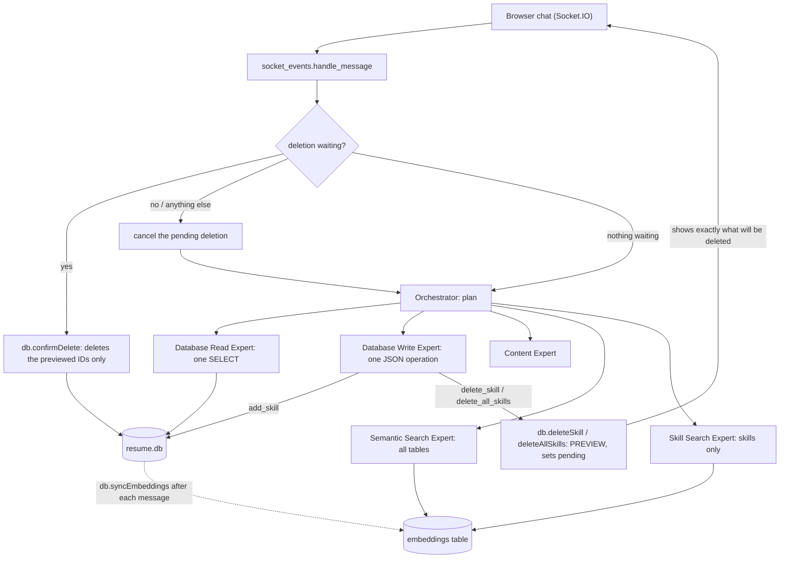

# Design and Testing Report — Homework 2

**Name:** Mohammed Jarada
**GitHub fork/branch URL:** [FILL]
**Demo video link:** [FILL]
**Command that runs my tests:** [FILL: the test command from the assignment/README]

## 0. Starting point

My HW1 worked in the browser, but it did not pass the restart test, and these were the first things I had to fix:

- **Restart test:** `createTables(purge=True)` rebuilt the database from the CSVs at every start, so every chat change was lost. Setting `purge=False` was not enough: `_seed_table` uses `INSERT OR IGNORE` on every start, so a deleted CSV skill (AutoCAD) came back with its old ID, and edits to `llm_roles.csv` were ignored because the prompt rows already existed.
- **Where `eval()`/`exec()` were:** `run_orchestrator_plan()` used `eval()` on the Orchestrator's plan, and `execute_write_action()` used `exec()` on the Write Expert's generated Python (both in `flask_app/utils/llm.py`).
- **Embedding test:** my first call failed with HTTP 400 because `EMBEDDING_MODEL` held my chat model (`openai/gpt-4o-mini`). With a real embedding model the check passed ("MSU" vs "Michigan State University" 0.827; vs "banana bread recipe" 0.081).

## 1. How my system works



Tables: `institutions`, `positions`, `experiences`, `skills`, `llm_roles` (prompts), `embeddings`, `seeded_tables` (which tables were already loaded from CSV).

- **Startup (changed):** each resume table is loaded from its CSV once (tracked in `seeded_tables`), so deleted rows stay deleted; the `llm_roles` prompts are re-read from the CSV on every start, so prompt edits take effect. Records are then embedded (`embeddings.backfill`).
- **Orchestrator (changed):** returns a plan that is read as data (a regex pulls out each `role`/`message`; only five known role names are accepted; at most 4 steps). A later step can use an earlier result via `{{step1}}`. No `eval()`.
- **Exact vs fuzzy (new):** counts and "list all" go to the Database Read Expert (SQL). Abbreviations, names, categories and topics go to a search expert, which embeds the question and ranks stored embeddings by cosine similarity above `SEARCH_MIN_SCORE`.
- **Write Expert (changed):** no longer writes code. It returns one JSON operation (`add_skill`, `delete_skill`, `delete_all_skills`); `execute_write_action()` checks the operation name and every value and calls a fixed database method. No `exec()`.
- **Approval (new):** a delete only *previews* (`pending` = the exact skill IDs and the message shown). `db.confirmDelete()` is the only code that deletes, it deletes exactly those IDs, and it is only called from the chat handler on an exact `yes`. Any other message cancels the pending deletion.

## 2. Where to find things in my code

| What | File / function / table |
| --- | --- |
| Search by meaning (returns table, ID, text, score) | `flask_app/utils/embeddings.py`: `search()`, `rank()`, `cosine()`; table `embeddings`; routing in `llm.py`: `SEARCH_ROLES`, `semantic_search()` |
| Trace output | Terminal lines `[Orchestrator] step N: <role>: <message>` and `[<role>] generated:` from `llm.py` [UPDATE if you added the Step 6 trace with request ID and approval state] |
| Test command | [FILL] |
| Settings (`.env.example`) | `.env.example`: `OPENROUTER_API_KEY`, `EMBEDDING_MODEL`, `SEARCH_MIN_SCORE` |
| Approval check and allowed operations | `database.py`: `deleteSkill`, `deleteAllSkills` (preview), `confirmDelete`, `cancelDelete`; `socket_events.py`: `YES`/`NO` and the pending check; `llm.py`: `execute_write_action` (allowed: `add_skill`, `delete_skill`, `delete_all_skills`) |
| Startup / data persistence | `database.py`: `createTables`, `_sync_llm_roles`, table `seeded_tables`; `RESET_DB` in `__init__.py` |
| Embedding validation | `embeddings.py`: `validate_vector()`, `embed_texts()`, `backfill()` |
| Choosing the cut-off | `score_check.py` |

## 3. Decisions I made

| Decision | Options I considered | What I chose | Why, and the trade-off | What would make me choose differently |
| --- | --- | --- | --- | --- |
| 1. Which tables a search covers | Always all tables; skills only; choose per question | Two search experts: **Skill Search Expert** (skills only) and **Semantic Search Expert** (all tables). The Orchestrator picks. | A skills question expects skill records, so mixing record types makes answers less precise: unrestricted search put an experience (0.506) in the results for "project management" and an institution (0.346) for "design software". Broad wording can also let a long text outrank skills: for "city planning" a position (0.553) beat every skill. But the top result for my skill queries was the same either way (3 of 3), so the gain is small on this data. Cost: the Orchestrator must route correctly, and a skill hidden in a non-skill-sounding question is missed. | If routing mistakes show up in tests, or the data stays this small, I would search all tables and label the record type. |
| 2. "No match" cut-off | Midpoint of the gap (0.33); 0.35; 0.40; always return top-k | `SEARCH_MIN_SCORE=0.35`, a fixed cut-off read from `.env` | Measured best scores of queries that should find nothing: Harvard 0.184, quantum physics 0.123, banana bread recipe 0.083, and a near-miss, "programming" → AutoCAD 0.321. Weakest correct top result: 0.474 ("managing a team"). 0.35 clears every miss with a margin of 0.03 and keeps relevant lower results (Revit 0.385). 0.33 leaves only 0.009 over the near-miss; 0.40 would drop Revit 0.385 and "Coordination & Management" 0.388. Too low returns weak matches and the agent answers from them; too high only makes the agent say "not found", which the user can rephrase. Trade-off: 0.35 also drops a marginal hit (Engineering Consultancy 0.346). | The cut-off belongs to the embedding model: after switching `EMBEDDING_MODEL` I must rerun `score_check.py` and update it. |
| 3. Text embedded per record | Name only; all columns; descriptive columns combined | Institutions: name, type, department, city, state. Positions: title, institution name, responsibilities. Experiences: name, description. Skills: skill name + experience name. IDs, dates, hyperlinks and `skill_level` are left out. | Combined text gives context that fuzzy questions need ("Gaza", "Urban Redevelopment") at the cost of diluting a pure name match. Leaving out `skill_level` means a level change never needs a new embedding (a number carries no meaning). | If `score_check.py` showed skill name alone scoring better for skill queries, I would drop the experience name. |
| 4. What happens to an embedding when its record changes | Keep old vectors; re-embed everything on every start; compare text | **Delete:** remove the embedding immediately (and again on startup for any leftover). **Edit:** re-embed only if the text that was embedded differs from the stored text. **Re-embedding fails:** remove the old embedding and report the failure. A single `syncEmbeddings()` runs after each chat message. | A surviving embedding would make search return a record that no longer exists. Comparing the stored text catches every kind of edit with no API call when nothing changed. A stale vector describes the old text and would look valid, so a failed record is left unsearchable (and reported) until the next successful run. A failed or all-zero vector is never stored. Trade-off: one extra scan of the tables per message. | With much more data I would update embeddings inside each operation instead of scanning. |
| 5. How startup keeps data | `purge=True` always; plain `purge=False`; seed once and sync prompts | `purge` only when `RESET_DB=1`; each resume table loaded from CSV once (`seeded_tables`); `llm_roles` upserted from its CSV at every start | Plain `purge=False` kept data but brought deleted skills back (`INSERT OR IGNORE`) and ignored prompt edits. Trade-off: after the first start, edits to the resume CSVs no longer change the database; I need a reset. | If the resume CSVs were the real source of truth, I would reseed them on every start. |
| 6. Approval and allowed operations | Ask in the prompt only; keep `exec()` with a check; fixed operations | Three allowed operations; the Write Expert only picks one as JSON; deletes only preview, and `confirmDelete()` deletes the exact previewed IDs on an exact `yes` | The check sits in the code that deletes, so no wording gets around it, and "Clean up my skills so the list is empty" maps to `delete_all_skills` and is stopped like any delete. Trade-off: the agent can only do what the operations list allows. | If more tables become editable, I would generalise the operations. |

## 4. Testing

Scenario IDs: [MAP each row to the S1–S11 / README ID].

| Scenario / what I typed | What should happen | What actually happened | Pass / fail | Evidence |
| --- | --- | --- | --- | --- |
| Restart test: delete AutoCAD with `yes`, restart | The skill stays deleted | Before the fix it came back (loader re-inserted CSV rows). After seed-once startup it stayed gone. | Fail, then pass | `peek.py "SELECT skill_id, name FROM skills"` before/after restart [ATTACH] |
| `Remove AutoCAD from the Urban Redevelopment experience`, then `yes` | Preview showing the skill, then deletion | Preview shown; after `yes`: "Deleted 1 skill(s)." and the row was gone | Pass | Chat reply and `peek.py` output [ATTACH] |
| `Clean up my skills so the list is empty` (S9, failure scenario) | Preview of ALL skills; nothing deleted until `yes` | First version: the Write Expert wrote `db.deleteSkill(None, None)`; nothing was deleted, but only by accident (no match, no preview). Now `delete_all_skills` shows `This will delete ALL N skills` and waits. | Fail, then [FILL after rerun] | Terminal `[Database Write Expert] generated:` block before/after [ATTACH] |
| `Do I have any design software skills?` | Skill Search Expert returns AutoCAD, Revit | Offline scores: AutoCAD 0.477, Revit 0.385 (both above 0.35) | Pass [confirm in the chat] | `score_check.py` output; terminal route line [ATTACH] |
| `Do I have any Harvard experience?` | "Not found", no invented record | Best score 0.184, below 0.35, so nothing is returned | Pass [confirm in the chat] | `score_check.py`; chat reply [ATTACH] |
| `How many skills do I have?` | Database Read Expert, not search | [FILL] | [FILL] | Terminal `[Orchestrator] step 1: Database Read Expert` [ATTACH] |
| `What skills did I use at the Gaza municipality?` (two dependent steps) | Step 1 search; step 2 uses its result via `{{step1}}` | [FILL] | [FILL] | Terminal step lines [ATTACH] |
| Preview a deletion, ask something else, then `yes` | The `yes` deletes nothing | [FILL] | [FILL] | `peek.py` before/after [ATTACH] |

**Things that surprised me:**

- With `purge=False` the Write Expert kept using the old prompt, because the CSV was never re-read. For "remove AutoCAD" it invented `db.deleteRow` and, another time, tried to *insert* an AutoCAD row with a NULL level. Only a `NOT NULL` constraint stopped it. I fixed it with a real delete method, and by syncing `llm_roles` at every start.
- "Urban Planner" is a position title; the experience is "Urban Redevelopment". The delete said "not found" until I used the right name; `deleteSkill` now accepts either.
- The Orchestrator once returned a malformed list (a stray `'` after `)]`), and `eval()` failed. Reading the plan with a regex and accepting only known role names removed that failure and the `eval()`.
- The Orchestrator copied an example that had no quotes around the role and message, which broke the parser. I fixed the example.
- The final reply step rewrote the Write Expert's exact message, so a deletion preview is now returned directly and never reworded.

[ADD anything that still fails and what its impact is.]

## 5. Limitations

1. **Limitation:** the cut-off (0.35) was measured with one embedding model on a small resume. **Impact:** after a model change or much more data, scores shift, and a stale cut-off returns weak matches or hides real ones. **How I'd improve it:** store the cut-off per model, and run `score_check.py` as part of the tests.
2. **Limitation:** routing depends on the Orchestrator model choosing the right expert and search type. **Impact:** a fuzzy question sent to the Read Expert returns "no rows" and an exact question sent to search returns weak matches. **How I'd improve it:** add routing tests (exact vs fuzzy) and more examples in the Orchestrator's prompt.
3. **Limitation:** the pending deletion is stored once on the shared database object, not per chat session. **Impact:** a second browser tab could answer another tab's pending deletion. **How I'd improve it:** key the pending action by session ID (`request.sid`).
4. **Limitation:** [FILL: e.g. the trace is only terminal lines without request ID and approval state, if Step 6 is not finished].

## 6. My work and the help I used

[EDIT to say what you actually did.] I used Claude (an AI assistant) to discuss design choices and to draft code and prompts: the startup logic, the embeddings module, the search functions, the delete and approval methods, and the Orchestrator and Write Expert prompts. I ran each step myself, collected the terminal output, and debugged the errors that came up (indentation errors, missing methods, a stale prompt table, a wrong embedding model name, the position-title mix-up). I made the decisions in section 3 after looking at my own scores and logs. I used Flask, Flask-SocketIO, Jinja2, `requests`, `python-dotenv` and the OpenRouter API; the starter code was the course's HW1 app.

## 7. How to run it

```powershell
python -m pip install -r requirements.txt     # or: flask flask-socketio python-dotenv requests jinja2
copy .env.example .env                         # then fill in the three settings below
python app.py                                  # starts the app; records are embedded at startup
[FILL: test command]
python score_check.py                          # prints the scores used to choose SEARCH_MIN_SCORE
```

Settings needed in `.env` (names only): `OPENROUTER_API_KEY`, `EMBEDDING_MODEL`, `SEARCH_MIN_SCORE`.

**Reset the test data only** (this wipes everything the chat changed and reloads the CSVs; do not use it on real data):

```powershell
$env:RESET_DB="1"; python app.py
# stop the app with Ctrl+C, then:
Remove-Item Env:RESET_DB
```

Back up `flask_app/database/resume.db` first if you want to keep your current data. After a model change, rerun `python score_check.py` and update `SEARCH_MIN_SCORE`.
