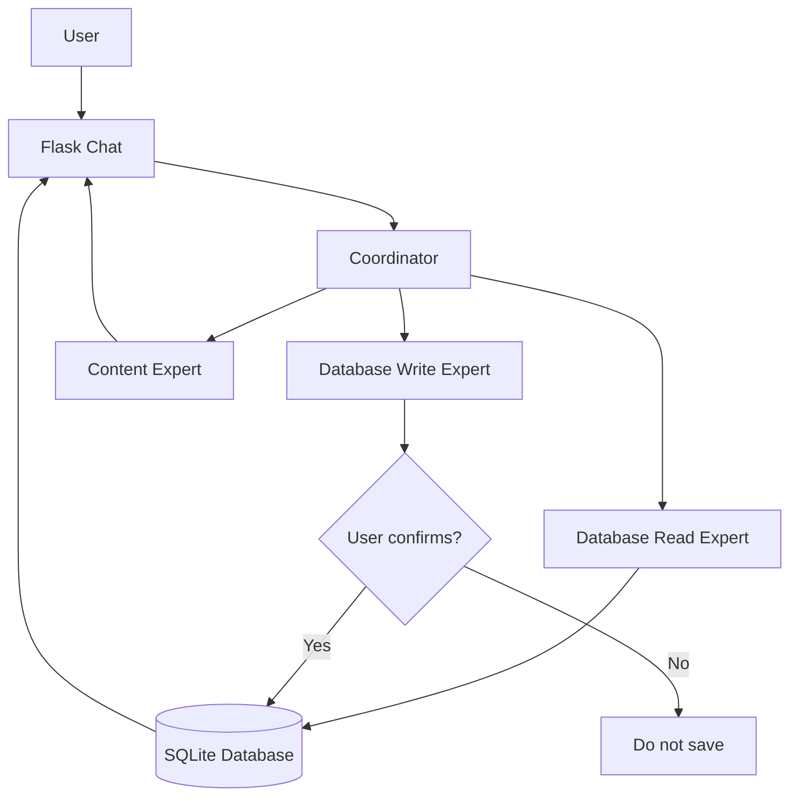

# Design and Testing Report — Homework [2]

**Name:**
**GitHub fork/branch URL:**
**Demo video link:**
**Command that runs my tests:**

> Keep it short and specific. A few clear sentences about *your* system are worth more than long general explanations.

## 0. Starting point

- **HW2:** Did your HW1 pass the "Before You Start" checks (works, restart test, where `eval()`/`exec()` were, embedding test)? What did you have to fix first?

## 1. How my system works

Add a simple diagram (Mermaid, a drawing exported as an image, or a photo of a clear sketch). Show the experts/agents, the database tables, where the approval check happens (HW2).

Then explain each main part in one or two sentences, and say **what changed from the previous homework**.

My system uses Flask for the chat interface and a Coordinator to select the correct AI expert. The Database Read Expert retrieves resume information, the Database Write Expert handles skill updates, and the Content Expert answers general questions. SQLite stores the resume data. In Homework 2, I added a confirmation step before saving new skills, so the user must approve the change first.

## 2. Where to find things in my code

|
| What | File / function / table |
|---|---|
| Search by meaning (returns table, ID, text, score) | flask_app/utils/llm.py — embedding code (lines 295–315); full similarity search not yet verified|
| Trace output |flask_app/utils/socket_events.py — line 197 uses traceback.print_exc() for error debugging; dedicated AI trace output not verified |
| Test command | No test_*.py, *_test.py, or pytest.ini files found in the project search. Test command not yet identified. |
| Settings (`.env.example`) | `.env.example` — verified file exists; `.env` — local settings file |
| Approval check and allowed operations (HW2) | `flask_app/utils/socket_events.py` — `pending_skills`, confirmation check; `flask_app/utils/database.py` — `addSkill()` |

## 3. Three decisions I made

Fill this in for **at least three** real choices. "Because it was easier" is not enough. Say what you gained and what you gave up.

| Decision | Options I considered | What I chose | Why, and the trade-off | What would make me choose differently |
|---|---|---|---|---|
| 1. Approval before saving | Save immediately or ask for confirmation | Ask for confirmation | Prevents accidental changes, but requires an extra message | For automatic updates explicitly authorized by the user |
| 2. Tracking pending changes | Store pending skills by session or use one shared variable | Store by session ID (`request.sid`) | Keeps users' pending requests separate, but adds session management | For a strictly single-user application |
| 3. Handling AI errors | Let errors interrupt requests or catch exceptions | Catch exceptions and return an error message | Gives users feedback, but does not automatically fix the error | If I add automatic retries and recovery |
                                    

Ideas for HW2: separate Semantic Search Expert vs. extending the Read Expert; what text you embed; when embeddings are updated; how startup keeps data; exact vs. search by meaning; which tables a search covers and how you chose the cut-off score; how `yes` is matched to the action; your allowed operations. If you did the bonus: ReAct vs. planning up front, and your round limit.

## 4. Testing

Use the scenario IDs from the README: **S1–S11** (plus **R1–R3** if you did the bonus) for HW2. Analyze at least **5** including at least one failure scenario.

| Scenario / what I typed | What should happen | What actually happened | Pass / fail | Evidence (test output, screenshot, log) |
| ----------------------- | ------------------ | ---------------------- | ----------- | --------------------------------------- |
|                         |                    |                        |             |                                         |
|                         |                    |                        |             |                                         |
|                         |                    |                        |             |                                         |
|                         |                    |                        |             |                                         |
|                         |                    |                        |             |                                         |
|                         |                    |                        |             |                                         |

Describe anything that surprised you: how you found the cause, and whether you fixed it. If something still fails, say what the impact is. Don't hide it.

## 5. Limitations

1. **Limitation:** … **Impact:** … **How I'd improve it:** …
2. **Limitation:** … **Impact:** … **How I'd improve it:** …

## 6. My work and the help I used

What did you write or change yourself? What did you reuse (starter code, libraries, documentation, AI tools), and for what? What did you test or change after getting help?

## 7. How to run it

The commands a grader needs to set up, run and test your app with the test data. Name the settings needed in `.env` (no values, no keys). Explain how to reset **the test data only**.